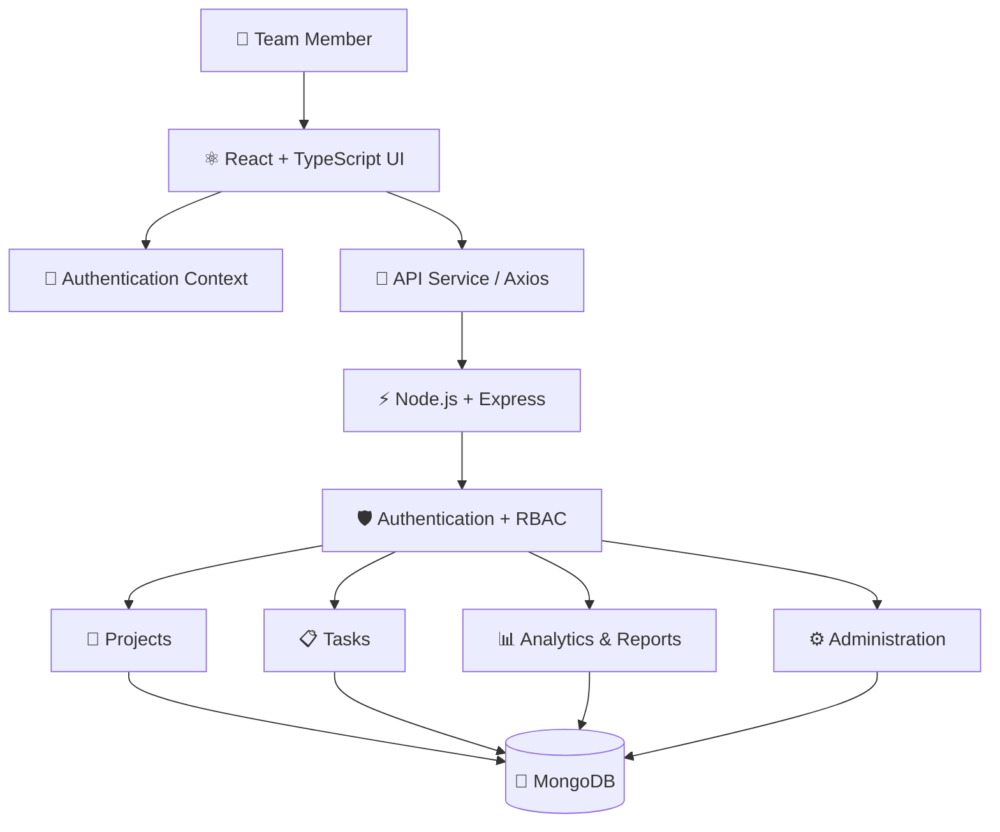
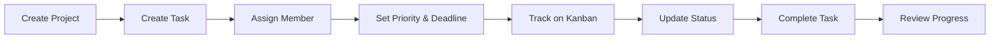
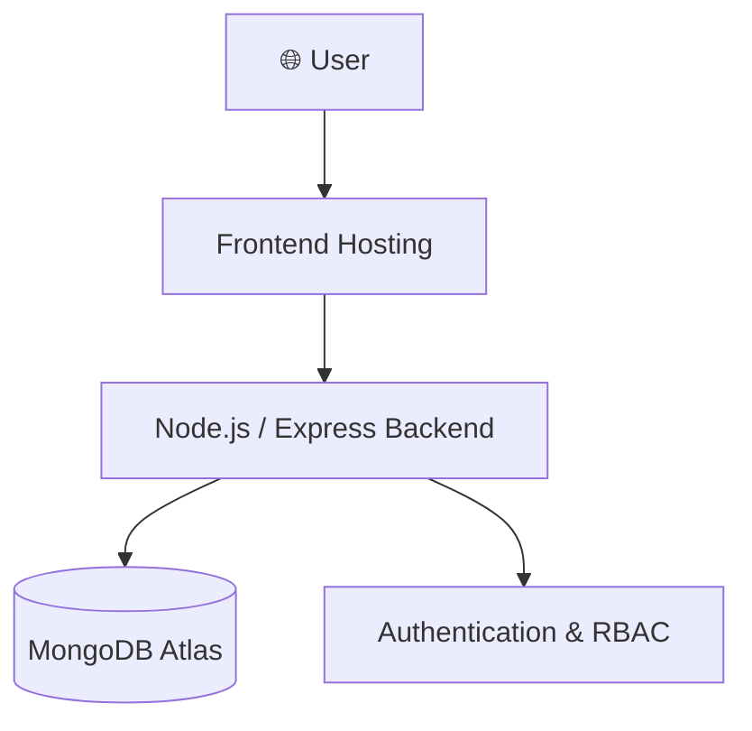

# 🚀 Team Task Manager v2

<p align="center">
  
</p>

<p align="center">
  
</p>

<p align="center">
  
  
  
  
</p>

<p align="center">
  <strong>A full-stack collaboration platform for organizing projects, managing tasks, tracking progress, and coordinating teams in one workspace.</strong>
</p>

<p align="center">
  <a href="#-overview">Overview</a> •
  <a href="#-features">Features</a> •
  <a href="#️-architecture">Architecture</a> •
  <a href="#-installation">Installation</a> •
  <a href="#-roadmap">Roadmap</a>
</p>

---

## 🌌 Overview

**Team Task Manager v2** is a full-stack project and task management application designed to help teams plan work, coordinate responsibilities, and monitor project progress.

It combines a modern React interface with a Node.js and Express API, MongoDB persistence, secure authentication, and role-based permissions.

The platform brings together task boards, project organization, calendar planning, analytics, notifications, and administration in one unified workspace.

### ✨ The Core Experience

<table>
<tr>
<td width="33%" align="center">

### 📋 Plan

Organize projects, tasks, priorities, and deadlines.

</td>
<td width="33%" align="center">

### 🤝 Collaborate

Coordinate team members, leads, and administrators.

</td>
<td width="33%" align="center">

### 📊 Track

Monitor progress, task status, and team performance.

</td>
</tr>
</table>

---

## 🚀 Features

### 📊 1. Productivity Dashboard

- Centralized overview of projects and tasks
- Task status and progress summaries
- Quick access to important activities
- Team-oriented productivity information

### 📋 2. Kanban Task Management

Organize tasks using a visual workflow.

```text
┌────────────────┐
│    TO DO       │
│                │
│  New Tasks     │
└───────┬────────┘
        │
        ▼
┌────────────────┐
│  IN PROGRESS   │
│                │
│ Active Work    │
└───────┬────────┘
        │
        ▼
┌────────────────┐
│     REVIEW     │
│                │
│ Verify Results │
└───────┬────────┘
        │
        ▼
┌────────────────┐
│      DONE      │
│                │
│ Completed Work │
└────────────────┘
```

- Visual task organization
- Task status tracking
- Priority and deadline management
- Drag-and-drop Kanban interactions using the configured drag-and-drop library

### 👥 3. Role-Based Access Control

The application supports role-oriented workflows.

| Role | Responsibility |
|---|---|
| 👑 Admin | Administrative management and platform oversight |
| 🧭 Team Lead | Team coordination and project management |
| 👤 Regular Member | Access and manage permitted tasks |

Permissions should be enforced by the backend API, not only hidden in the frontend.

### 📅 4. Calendar and Scheduling

- Calendar-oriented task planning
- Deadline visibility
- Upcoming work organization
- Better awareness of project timelines

### 📈 5. Analytics and Reports

- Task completion tracking
- Project progress summaries
- Team activity insights
- Reporting-oriented dashboard views

### 🔔 6. Notifications

- Task-related notifications
- Updates for relevant activities
- Better visibility into project changes

### 🛡️ 7. Authentication and Security

- JWT-based authentication
- HTTP-only cookie support
- Bearer-token authentication where configured
- Role-based authorization
- Protected routes and API endpoints

### ⚙️ 8. Administration

- Administrative dashboard
- User and team oversight
- Project and task administration
- Role-aware management workflows

---

## 🎬 Animated Project Showcase

<p align="center">
  
</p>

<table>
<tr>
<td width="50%" align="center">

### 📊 Dashboard

Get a centralized view of project activity and progress.

</td>
<td width="50%" align="center">

### 🗂️ Kanban Board

Move tasks through the workflow and track their status.

</td>
</tr>
<tr>
<td width="50%" align="center">

### 📅 Calendar

Organize tasks and monitor upcoming deadlines.

</td>
<td width="50%" align="center">

### 📈 Analytics

Understand completion trends and project progress.

</td>
</tr>
</table>

> **Tip:** Add screenshots or a short GIF from the actual application to make this section a real product showcase.

---

## 🏗️ Architecture



### Architecture Layers

| Layer | Responsibility |
|---|---|
| Frontend | Interface, dashboard, Kanban, calendar, and forms |
| Context | Authentication and theme state |
| API service | HTTP communication with backend endpoints |
| Express API | Request routing and application logic |
| Middleware | Authentication and permission enforcement |
| MongoDB | Persistent user, project, and task data |
| Analytics | Aggregated task and project information |

---

## 🔄 Task Lifecycle



This workflow provides a consistent way to organize work from initial planning through completion.

---

## 🧰 Technology Stack

### Frontend

<p align="center">
  
</p>

- React 18
- TypeScript
- Vite
- Tailwind CSS
- React Router
- Zustand, where used for application state
- dnd-kit for drag-and-drop interactions

### Backend

<p align="center">
  
</p>

- Node.js
- Express.js
- TypeScript
- REST API architecture
- JWT authentication
- Role-based access control

### Database

<p align="center">
  
</p>

- MongoDB
- Database models for application data
- Structured API-to-database interactions

### UI and Development Tools

<p align="center">
  
</p>

- Tailwind CSS
- Git and GitHub
- Visual Studio Code
- npm

---

## 🗃️ Data Model

The database schema should remain the source of truth for the models implemented in the repository.

Typical entities in a task management application include:

| Entity | Purpose |
|---|---|
| User | User profiles, roles, and authentication information |
| Project | Project metadata and ownership |
| Task | Description, status, priority, and deadlines |
| Team | Team membership and coordination |
| Notification | Task-related alerts and updates |
| Activity | Project activity and audit history |
| Report | Aggregated progress information, where persisted |

Actual model names and relationships may differ based on your MongoDB schemas.

---

## 🔌 API Design

The backend organizes operations around application resources.

| Functional Area | Typical Operations |
|---|---|
| Authentication | Register, login, profile, logout |
| Users | View and manage permitted user information |
| Projects | Create, list, update, delete |
| Tasks | Create, assign, update status, manage deadlines |
| Calendar | Retrieve tasks for a time period |
| Analytics | Retrieve task and project summaries |
| Notifications | Retrieve and manage notifications |
| Administration | Authorized management operations |

### Example API Request

```http
GET /api/tasks
Accept: application/json
```

### Example Response

```json
{
  "success": true,
  "data": [
    {
      "id": "example-task-id",
      "title": "Implement dashboard",
      "status": "in-progress",
      "priority": "high"
    }
  ]
}
```

This is an illustrative example. Refer to the actual backend routes and response schemas for the exact API contract.

---

## 🔐 Security

Security is essential when multiple users share projects and tasks.

- Validate requests on the server.
- Protect sensitive routes with authentication middleware.
- Enforce permissions based on user roles.
- Hash passwords securely.
- Configure HTTP-only cookies where applicable.
- Validate ownership before allowing task or project changes.
- Store secrets in environment variables.
- Restrict CORS to trusted origins in production.
- Avoid committing credentials or real user data.

JWT authentication alone does not replace authorization checks or secure session configuration.

---

## 💻 Installation

### Prerequisites

- Node.js
- npm
- MongoDB instance or configured MongoDB Atlas database
- Git

### 1. Clone the Repository

```bash
git clone YOUR_EXISTING_REPOSITORY_URL
cd YOUR_PROJECT_DIRECTORY
```

Replace the placeholders with your actual repository URL and project directory.

### 2. Install Backend Dependencies

Navigate to your backend directory:

```bash
cd backend
npm install
```

### 3. Configure Backend Environment Variables

Create a `.env` file using your project's existing `.env.example`.

Example variables:

```env
PORT=5000
NODE_ENV=development
MONGODB_URI=your_mongodb_connection_string
JWT_SECRET=replace_with_a_secure_random_secret
FRONTEND_URL=http://localhost:5173
```

Use the exact variable names and values expected by your implementation.

### 4. Start the Backend

```bash
npm run dev
```

Use the backend's configured development script if it differs.

### 5. Install Frontend Dependencies

Open another terminal and navigate to the frontend directory:

```bash
cd frontend
npm install
```

### 6. Start the Frontend

```bash
npm run dev
```

Open the local URL printed by Vite, commonly:

```text
http://localhost:5173
```

> Your repository may use a root-level package or different frontend/backend directory names. Follow the actual project structure and `package.json` scripts.

---

## 🧪 Testing and Quality

Recommended testing areas include:

- Login and registration validation
- Protected routes and unauthorized requests
- Admin, team lead, and member permissions
- Project creation and updates
- Task assignment and status changes
- Kanban interactions
- Deadline and calendar behavior
- Analytics calculations
- MongoDB error handling
- API input validation

Run the test commands configured in the relevant package files.

---

## 📸 Screenshots

### Dashboard

<p align="center">
  
</p>

### Kanban Board

<p align="center">
  
</p>

### Calendar

<p align="center">
  
</p>

### Analytics

<p align="center">
  
</p>


---

## ☁️ Deployment

A typical deployment topology can look like this:



### Deployment Checklist

- Configure the production database URI.
- Set secure authentication secrets.
- Configure the frontend API base URL.
- Allow only trusted frontend origins through CORS.
- Verify role permissions on the backend.
- Check production build and API connectivity.
- Ensure sensitive environment files are excluded from Git.
- Test the deployed application on desktop and mobile.

---

## 🛣️ Roadmap

- [ ] Improve dashboard visualizations
- [ ] Enhance task filtering and search
- [ ] Add richer project reporting
- [ ] Improve calendar interactions
- [ ] Expand notification preferences
- [ ] Add more comprehensive automated tests
- [ ] Improve accessibility and keyboard navigation
- [ ] Add audit logging for administrative actions
- [ ] Optimize database queries and API responses
- [ ] Improve deployment monitoring and error reporting

---

## 🧠 What This Project Demonstrates

- Full-stack development using React and Node.js
- REST API design with Express
- Type-safe application development with TypeScript
- MongoDB data modeling
- JWT-based authentication
- Role-based authorization
- Drag-and-drop UI interactions
- Dashboard and analytics development
- Application security fundamentals
- Frontend/backend integration and deployment

---

## 👨‍💻 Developer

**Dhanush Gopi Kavala**

Full-Stack Developer | Software Engineering Graduate

<p align="center">
  <a href="https://github.com/dhanushgopi2456">
    
  </a>
  <a href="https://www.linkedin.com/in/dhanush-gopi-kavala-a460a528b/">
    
  </a>
</p>

---

<p align="center">
  
</p>

<p align="center">
  <strong>🚀 Plan. Collaborate. Deliver.</strong><br/>
  <em>Team Task Manager v2 — Better teamwork starts with better workflows.</em>
</p>
